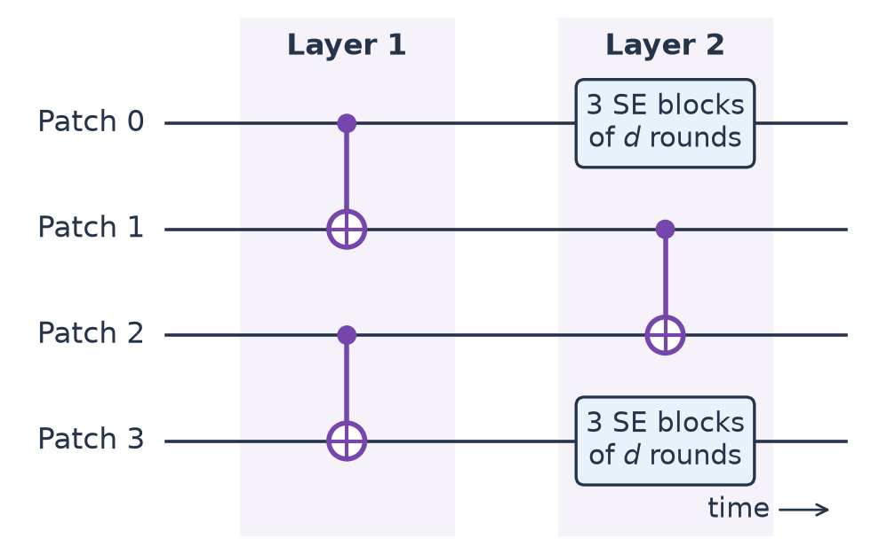
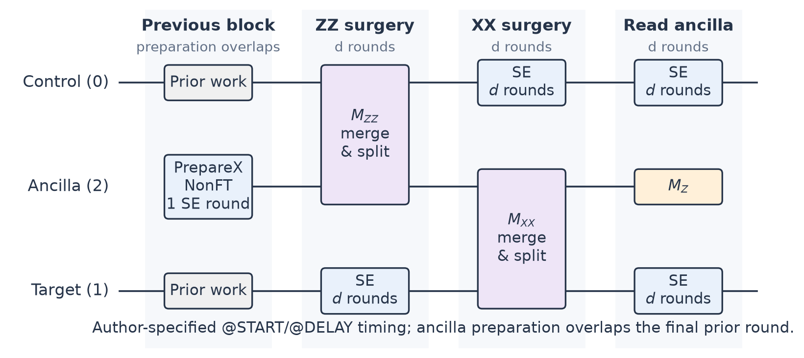
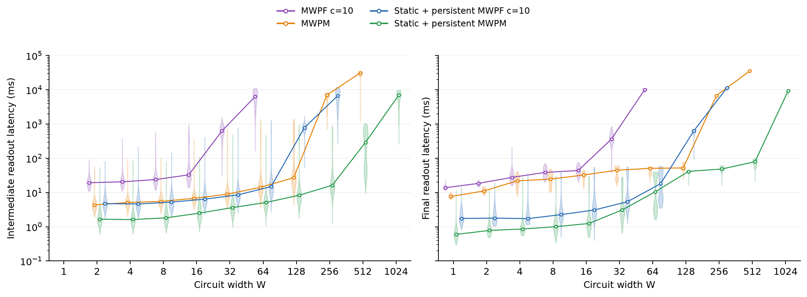
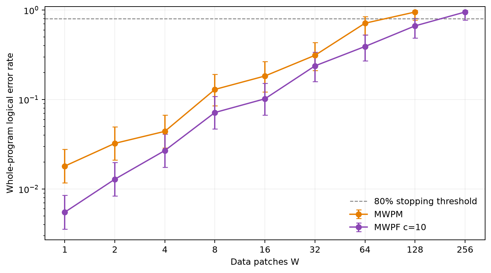

# Decoder performance: more than a fast solver

A decoding system must keep up with a stream of measurements, not just solve one graph
quickly. Compilation, graph preparation, and scheduling all contribute to the
time before a logical result is available. This chapter uses a growing
lattice-surgery circuit to show where those costs matter.

## The workload: a brickwall of logical CNOTs

Imagine a row of surface-code patches. One layer applies CNOTs to pairs
`(0,1), (2,3), ...`; the next shifts the pairs to `(1,2), (3,4), ...`.
The alternating pattern looks like a brick wall:



Filled dots mark controls and circled plus signs mark targets. Each wire represents a **logical
patch**, not a physical qubit. Idle patches still perform syndrome extraction
so that errors remain detectable.

This small DEQ program illustrates two layers on four patches. It uses the
gadget definitions from the [workload library](../examples/jit-basics/lattice_surgery.py):

```deq
PROGRAM Brickwall {
    @START(at=0,duration=0.07)
    PrepareZ0 0
    @START(at=0,duration=0.07)
    PrepareZ0 1
    @START(at=0,duration=0.07)
    PrepareZ0 2
    @START(at=0,duration=0.07)
    PrepareZ0 3

    # Ancilla preparation overlaps the preceding data block.
    @START(at=0.06,duration=0.22)
    CNOT 0 1
    @START(at=0.06,duration=0.22)
    CNOT 2 3

    @START(at=0.27,duration=0.22)
    CNOT 1 2
    @START(at=0.28)
    REPEAT 3 {
        @DELAY(0.07)
        Syndrome 0
    }
    @START(at=0.28)
    REPEAT 3 {
        @DELAY(0.07)
        Syndrome 3
    }

    @START(at=0.49,duration=0.07)
    MeasureZ 0
    @START(at=0.49,duration=0.07)
    MeasureZ 1
    @START(at=0.49,duration=0.07)
    MeasureZ 2
    @START(at=0.49,duration=0.07)
    MeasureZ 3
}
```

Each REPEAT sets the PROGRAM cursor to 0.28 s once, then advances it by 0.07 s
before each syndrome call. These zero-duration calls deliver at 0.35, 0.42,
and 0.49 s. Use explicit call durations when execution intervals, rather than
only measurement delivery times, need to be modeled.

The evaluation scales this to **W data patches and 50 layers**, with random
computational-basis inputs. Ancilla patches used during surgery are additional
to W.

## What one CNOT becomes

Lattice surgery implements the logical CNOT through joint measurements.
An ancilla is prepared in `|+>`, coupled first to the control through a ZZ
measurement, then to the target through an XX measurement, and finally measured
in Z. Each stage includes syndrome extraction:



The ancilla's **PrepareXNonFT uses one SE round**, overlapped with the final round
of the preceding data block. It does not add a separate time block. 
Every idle **SE block lasts d rounds**. The ZZ and XX gadgets merge neighboring
patches, measure their joint parity for d rounds, and split them again.
The readout block retains its syndrome extraction before the final measurement.
Initial data-patch preparation is unchanged and still takes d rounds.
`NonFT` makes explicit that this preparation is not independently fault-tolerant;
the following merge supplies the additional syndrome history.

The library expresses that expansion as a reusable DEQ subprogram:

```deq
PROGRAM CNOT {
    INPUT SurfaceCode 0
    INPUT SurfaceCode 1
    @START(at=0,duration=0.01)
    PrepareXNonFT 2
    @START(at=0.01,duration=0.07)
    MZZ 0 2
    @START(at=0.01,duration=0.07)
    Syndrome 1
    @START(at=0.08,duration=0.07)
    MXX 2 1
    @START(at=0.08,duration=0.07)
    Syndrome 0
    @START(at=0.15,duration=0.07)
    MeasureZ 2
    @START(at=0.15,duration=0.07)
    Syndrome 0
    @START(at=0.15,duration=0.07)
    Syndrome 1
    CONDITIONAL rec[-2] Z0 0
    CONDITIONAL rec[-3] X0 1
    CONDITIONAL rec[-1] X0 1
    OUTPUT SurfaceCode 0
    OUTPUT SurfaceCode 1
}
```

`INPUT` and `OUTPUT` explicitly declare the subprogram's interface, in call
argument order. 
The numbers name patch wires: `PrepareXNonFT 2` creates the temporary ancilla on wire 2. `MZZ 0 2` measures the joint Z parity of wires
0 and 2.
The three `CONDITIONAL` statements use the
decoded XX, ZZ, and ancilla-Z readouts to update the Pauli frame; they do not
require extra physical correction gates but are just virtual Pauli frame corrections.
They complete automatically at the latest required dependency time, with zero
duration; do not annotate corrections directly.

These annotations author the physical schedule, not a post-export timing pass.
`@START` sets the local source cursor and the duration of that call only.
`@DELAY(seconds)` advances that cursor for following source statements.
An omitted duration is zero; definitions do not provide timing defaults.
Each subprogram has an independent clock relative to its invocation origin.
The native compiler sorts by completion time with source-order ties, remapping
logical references and physical measurement order together.

This explains two features of the benchmark: there are **intermediate readouts**
during surgery as well as **final readouts** of the data patches, and each
logical layer now occupies three timed blocks. With initial data preparation
and final measurement, 50 layers therefore produce **152 blocks**.

## Four decoder configurations to run the same circuit

| Configuration | Details |
| --- | --- |
| MWPF c=10 | runtime JIT compilation; a hypergraph decoder with `cluster_node_limit=10` |
| MWPM | runtime JIT compilation; matching on graphlike errors |
| Static + persistent MWPM | Compile the static program ahead of time; reuse loaded graphs and solver instances |
| Static + persistent MWPF c=10 | The same static execution and persistence, with MWPF and `cluster_node_limit=10` |

MWPF can represent errors involving more than two checks; MWPM filters out
unsupported hyperedges. The MWPF search limit controls work, not elapsed time.
Decoder choice can therefore affect accuracy as well as speed.

All four share immutable graph preparation where possible. Persistence goes
further by reusing mutable solver instances. Static execution also removes JIT
compilation from the online path, making it attractive for known, repetitive
programs.

## Measuring latency

The [evaluation runner](../examples/decoder-performance/README.md#build-and-run)
compares all four configurations at distance 7, `p=0.001`, 24 workers, and
70 ms per d-round block. Window decoding uses buffer radius 1 and lookahead 0.
Latency is measured from the last required **scheduled** input to window
commitment, including queueing, graph preparation, and solving.

The runner doubles width until each configuration first exceeds 1 second
(1,000 ms) in mean intermediate or final latency, with no default width cap.
An optional `--max-width` cap does not establish an overload point. Its plot separates surgery readouts
from final readouts; violin shapes show distributions and connected markers
show medians. W=1 is a memory-only control.

All four configurations use `deq simulate ler` on the same generated source,
with native strict timing and a single batch containing the full shot quota.
JIT metadata is submitted up to two blocks early, clipped at shot start, without
extra startup grace. Static runs use native in-process delivery. Scheduled times
are relative to each native `start_decoding` event; physical sampling and static
program setup occur before that origin and are excluded.
This compares the measured online execution paths, not solver cost alone.
Cold graphs, cold solvers, and logical-error shots remain in the measurements.

Every width uses fresh physical samples in all four configurations. Resource
guards fail explicitly instead of substituting replay or counting incomplete tasks.



The [measured data](../examples/decoder-performance/performance-data.json) contain
37 points, 813 shots, and 416,913 readout observations. Every published point
meets its sample quota and has no failed decoder shots.
These measurements used the previous 10-second stopping threshold and are
retained unchanged; future evaluations use the 1-second threshold.

| Configuration | Last measured width | Mean intermediate latency | Mean final latency | Status |
| --- | ---: | ---: | ---: | --- |
| MWPF c=10 | 64 | 6.112 s | 10.097 s | First mean above 10 s |
| MWPM | 512 | 30.516 s | 35.289 s | First mean above 10 s |
| Static + persistent MWPM | 1024 | 6.189 s | 9.403 s | Width limit; below the stopping threshold |
| Static + persistent MWPF c=10 | 256 | 6.528 s | 11.440 s | First mean above 10 s |

Static/persistent MWPM reached W=1024 without crossing the stopping threshold;
its endpoint is a width limit, not a measured overload point. All tasks completed
under the 48 GiB process-tree guard. The largest observed peak was 28.07 GiB,
at W=1024.

## Logical error rate on fresh samples

The following evaluation uses **fresh physical-noise samples**, not replay,
with the three-block CNOT schedule and `PrepareXNonFT`. We ran
`deq simulate ler` at distance 7, `p=0.001`, and 50 layers, using Z-basis
inputs, window buffer radius 1, lookahead 0, and no decoder persistence.
The source-defined execution order is retained, but wall-clock delivery delays
are disabled for this throughput-oriented evaluation. Each point accumulated
**20 logical errors**. The completed 17-point sweep contains 9,141 shots and
340 logical errors, with no failed decoder shots.



This is the probability that **any final logical assertion fails in the whole
program**, not the error rate of one CNOT or one patch. More patches and gates
provide more opportunities for failure, so large whole-program rates alone
do not establish a circuit bug. MWPF had a lower measured rate at every shared
width in this sweep.

| Decoder | Last completed width | Logical errors / shots | Whole-program LER | Status |
| --- | ---: | ---: | ---: | --- |
| MWPM | 128 | 20 / 21 | 95.2% | First point above the 80% stopping threshold |
| MWPF c=10 | 256 | 20 / 21 | 95.2% | First point above the 80% stopping threshold |

Error bars are approximate 95% Wilson intervals; error-count stopping is
adaptive, so they are not an anytime-valid confidence guarantee.

As circuit checks, the distance-7 single-CNOT circuits retained graphlike
circuit distance 7 in both X and Z bases and passed 40 noiseless control shots.
These checks found no correction-order or noiseless circuit failure, but are
not a proof of the large circuit's threshold behavior.
The [recorded counts and provenance](../examples/decoder-performance/ler-results.json)
use one native worker with 24 decoder threads throughout. Peak process-tree
memory was 10.79 GiB, below the 48 GiB guard.

## Explore further

- [LER data](../examples/decoder-performance/ler-results.json) contain
  the measured error counts and build provenance.
- [Evaluation guide](../examples/decoder-performance/README.md) explains setup,
  rerunning the sweep, and generating the full brickwall and surgery programs.
- To redraw the LER PNG from the saved data without running a simulation:

  ```bash
  python deq/documents/tutorial/examples/decoder-performance/evaluate_ler.py \
      --plot-only
  ```
