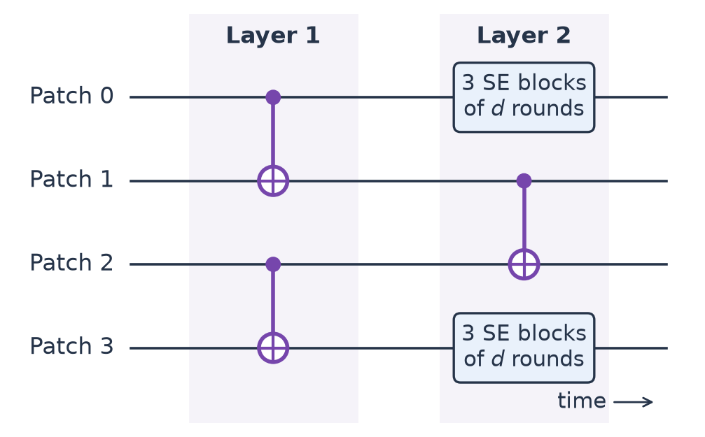
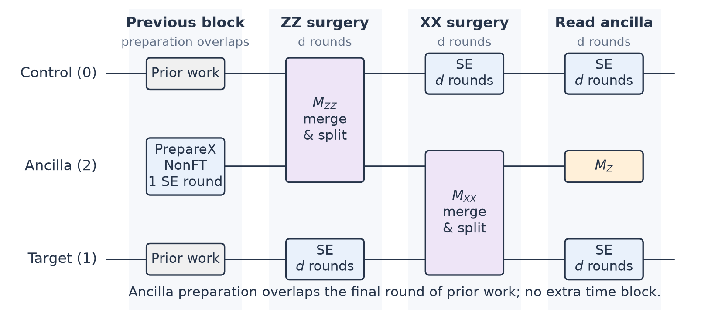
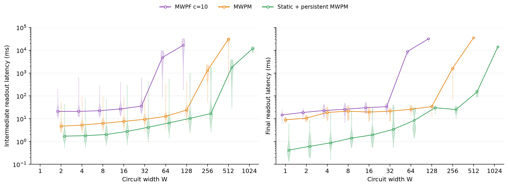

# Decoder performance: more than a fast solver

A decoding system must keep up with a stream of measurements, not just solve one graph
quickly. Compilation, graph preparation, and scheduling all contribute to the
time before a logical result is available. This chapter uses a growing
lattice-surgery circuit to show where those costs matter.

## The workload: a brickwall of logical CNOTs

Imagine a row of surface-code patches. One layer applies CNOTs to pairs
`(0,1), (2,3), ...`; the next shifts the pairs to `(1,2), (3,4), ...`.
The alternating pattern looks like a brick wall:



Filled dots mark controls and circled plus signs mark targets. Each wire represents a **logical
patch**, not a physical qubit. Idle patches still perform syndrome extraction
so that errors remain detectable.

This small DEQ program illustrates two layers on four patches. It uses the
gadget definitions from the [workload library](../examples/jit-basics/lattice_surgery.py):

```deq
PROGRAM Brickwall {
    PrepareZ0 0
    PrepareZ0 1
    PrepareZ0 2
    PrepareZ0 3
    CNOT 0 1
    CNOT 2 3
    CNOT 1 2
    REPEAT 3 { Syndrome 0 Syndrome 3 }
    MeasureZ 0
    MeasureZ 1
    MeasureZ 2
    MeasureZ 3
}
```

The evaluation scales this to **W data patches and 50 layers**, with random
computational-basis inputs. Ancilla patches used during surgery are additional
to W.

## What one CNOT becomes

Lattice surgery implements the logical CNOT through joint measurements.
An ancilla is prepared in `|+>`, coupled first to the control through a ZZ
measurement, then to the target through an XX measurement, and finally measured
in Z. Each stage includes syndrome extraction:



The ancilla's **PrepareX uses one SE round**, overlapped with the final round
of the preceding data block. It does not add a separate time block. The control
is untouched by ancilla preparation; its input port only anchors the schedule.
Every idle **SE block lasts d rounds**. The ZZ and XX gadgets merge neighboring
patches, measure their joint parity for d rounds, and split them again.
The readout block retains its syndrome extraction before the final measurement.
Initial data-patch preparation is unchanged and still takes d rounds.

The library expresses that expansion as a reusable DEQ subprogram:

```deq
PROGRAM CNOT {
    PrepareAncilla 0 2
    MZZ 0 2
    Syndrome 1
    MXX 2 1
    Syndrome 0
    MeasureZ 2
    Syndrome 0
    Syndrome 1
    CONDITIONAL rec[-2] Z0 0
    CONDITIONAL rec[-3] X0 1
    CONDITIONAL rec[-1] X0 1
}
```

The numbers name patch wires: `MZZ 0 2` measures the joint Z parity of wires
0 and 2. `PrepareAncilla 0 2` keeps the control on wire 0 and creates the
temporary ancilla on wire 2. The three `CONDITIONAL` statements use the
decoded XX, ZZ, and ancilla-Z readouts to update the Pauli frame; they do not
require extra physical correction gates.

This explains two features of the benchmark: there are **intermediate readouts**
during surgery as well as **final readouts** of the data patches, and each
logical layer now occupies three timed blocks. With initial data preparation
and final measurement, 50 layers therefore produce **152 blocks**.

## Three ways to run the same circuit

| Configuration | What changes |
| --- | --- |
| MWPF c=10 | JIT compilation; a hypergraph decoder with `cluster_node_limit=10` |
| MWPM | JIT compilation; matching on graphlike errors |
| Static + persistent MWPM | Compile the known program ahead of time; reuse loaded graphs and solver instances |

MWPF can represent errors involving more than two checks; MWPM filters out
unsupported hyperedges. The MWPF search limit controls work, not elapsed time.
Decoder choice can therefore affect accuracy as well as speed.

All three share immutable graph preparation where possible. Persistence goes
further by reusing mutable solver instances. Static execution also removes JIT
compilation from the online path, making it attractive for known, repetitive
programs.

## Reading the results

**Recorded baseline:** this plot measures the earlier four-block CNOT schedule,
including d rounds of ancilla preparation (202 blocks for 50 layers).
The shorter, overlapped schedule above has not been timed in this dataset.



The left panel shows surgery readouts; the right shows final data readouts.
Violin shapes show the distributions, and connected markers show **medians**.
Both axes are logarithmic. W=1 is a memory-only control with no surgery readouts.

At small widths, latency mainly reflects per-request overhead. As width grows,
the runtime eventually cannot keep pace, and queued work drives latency upward.
Each curve stops at the first width where **mean** intermediate or final latency
exceeds 10 seconds:

| Configuration | Stopping width | Mean intermediate latency | Mean final latency |
| --- | ---: | ---: | ---: |
| MWPF c=10 | 128 | 16.592 s | 31.171 s |
| MWPM | 512 | 28.522 s | 35.280 s |
| Static + persistent MWPM | 1024 | 11.735 s | 14.289 s |

The interesting improvement is not just the stopping width. At W=256, mean
final latency is **1.554 seconds** for JIT MWPM versus **25.6 milliseconds** for
static/persistent MWPM. Avoiding repeated setup can matter as much as making
the solver faster. But this compares complete execution paths, not persistence
alone: the static runner also uses in-process delivery rather than local gRPC.

### Conditions and limits

The DEQ 0.8.0-rc1 evaluation uses distance-7 patches, noise parameter `p=0.001`,
24 workers, and a 70 ms interval per block. All configurations use window
decoding with buffer radius 1 and lookahead 0. Latency runs from the scheduled
arrival of a window's last required input to its commitment, including queueing,
preparation, and solving.

JIT runs submit metadata two blocks early and allow startup grace; static runs
include code startup with no grace. Cold graphs and solvers remain in the
measurements. The figure contains 611 shots and 353,935 readout observations;
logical-error shots are not discarded.

**This is a throughput study, not a logical-error-rate comparison.** Above
W=128, wider circuits use extended measurement-replay fixtures rather than fresh
full-width noise trajectories. The crossings depend on this machine, workload,
and cadence, not a universal capacity limit.

## Explore further

- [Figure data](../examples/decoder-performance/performance-data.json) contain
  the measured distributions and build provenance.
- [Evaluation guide](../examples/decoder-performance/README.md) explains setup,
  rerunning the sweep, and generating the full brickwall and surgery programs.
- To redraw the PNG from the saved data without running a simulation:

  ```bash
  python deq/documents/tutorial/examples/decoder-performance/plot.py
  ```
