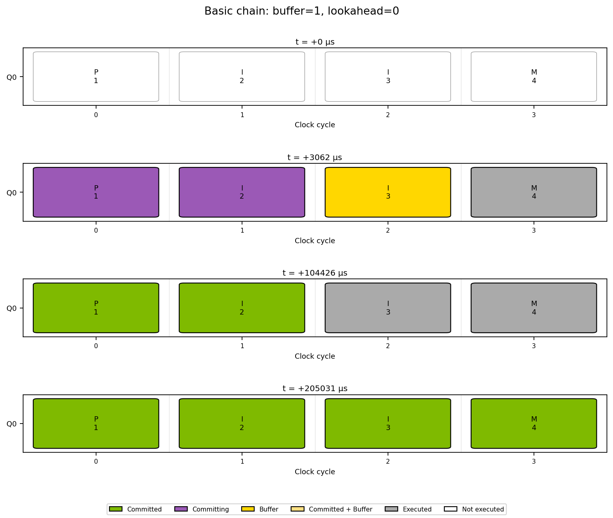
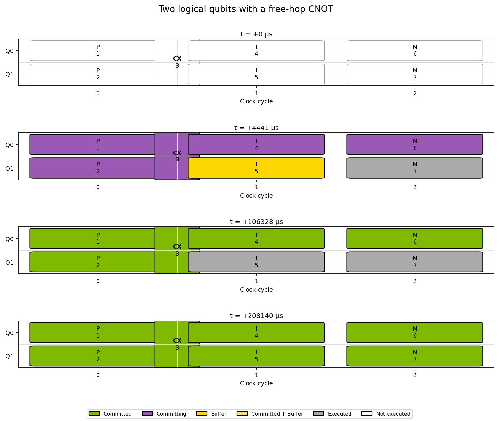
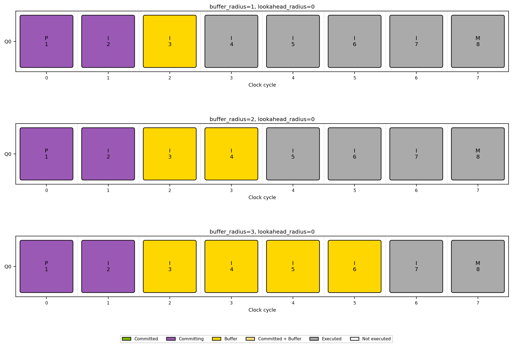
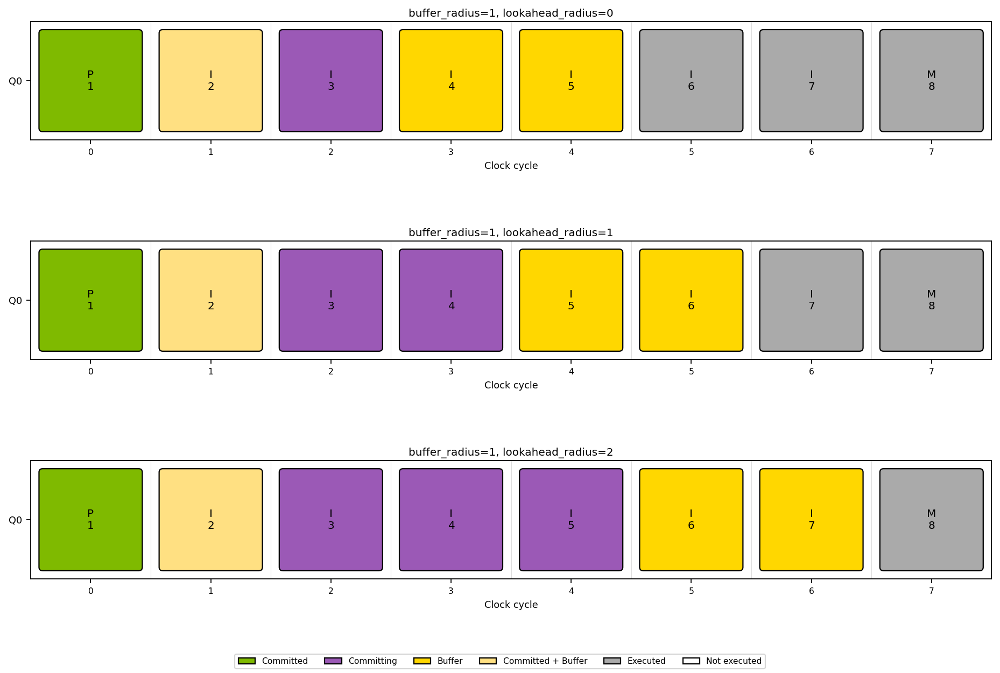
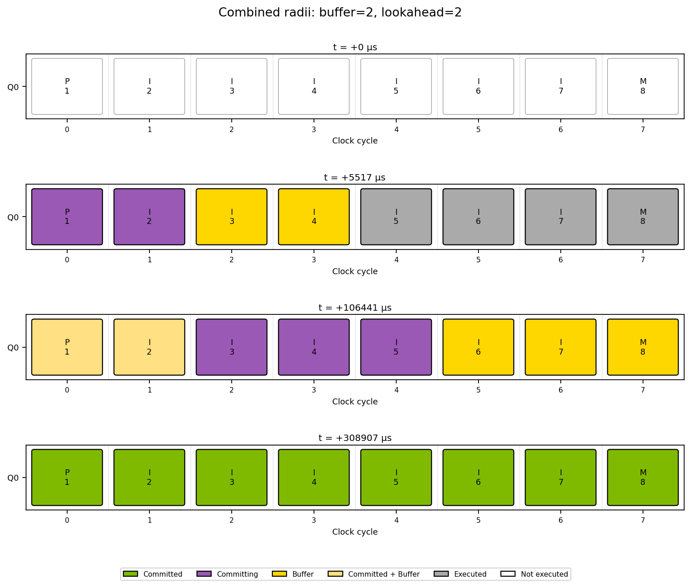
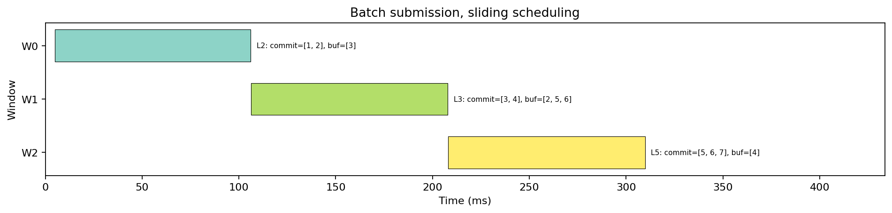
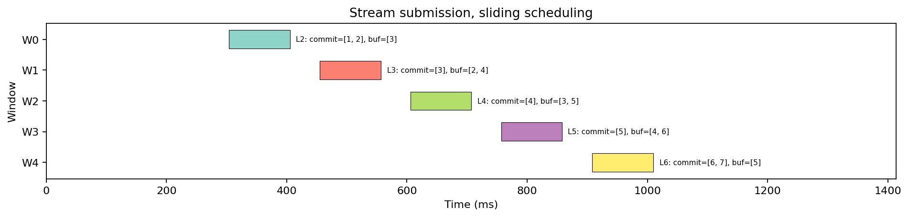
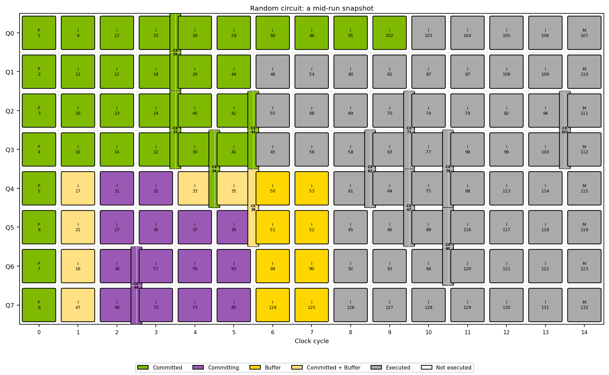
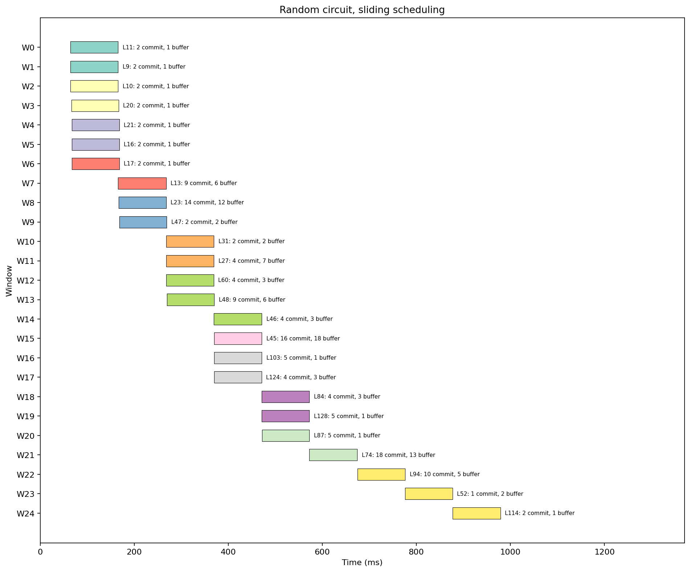

# Window decoding

Window decoding processes overlapping regions of a logical circuit instead of
waiting for the entire circuit to finish. Each decode finalizes corrections
for an inner **commit region**, using surrounding **buffer gadgets** as context.
The buffer is not necessarily committed by the same decode.

This chapter follows a three-qubit repetition code from a short memory circuit
to a branching circuit with transversal CNOTs. It replaces the former interactive
window-decoding notebook.

**Figure provenance:** All PNG figures in this chapter were generated with
**deq version 0.6.0**, using its window trace visualizer and the static plotting
functions from the
[original tutorial helpers](https://github.com/microsoft/qdk-ec/blob/725ea1cab22de6064091c8f9cfcc104e86ba8d72/deq/documents/examples/window_decoding_tutorial.py).
They are saved illustrations, not live widgets. Reading or building this chapter
does not require the retired visualizer, Node.js, Playwright, or a browser.
The visualizer's protobuf definitions remain available for processing existing
files.

The figures use a **mock decoder with a 100 ms delay** and all-zero measurement
outcomes. They illustrate scheduling and window membership, not physical noise
sampling, logical error rates, or decoder performance. Exact timings and window
leadership can vary between runs.

## Gadget vocabulary

The [example library](../examples/window-decoding/repetition_code.deq) contains
four gadget types:

| Gadget | Logical inputs | Logical outputs | Physical measurement bits |
| --- | ---: | ---: | ---: |
| `PrepareZ` | 0 | 1 | 0 |
| `Idle` | 1 | 1 | 2 |
| `MeasureZ` | 1 | 0 | 3 |
| `TransversalCNOT` | 2 | 2 | 0 |

`Idle` performs a round of syndrome extraction, rather than doing nothing.
`TransversalCNOT` acts between two encoded qubits without extracting a new
syndrome. `PrepareZ` prepares the data qubits directly in the Z basis.

In the figures, each row (`Q0`, `Q1`, ...) is a **logical wire**, not one physical
data qubit. Boxes show gadget instances: `P` for preparation, `I` for syndrome
extraction, `M` for measurement, and `CX` for transversal CNOT. Numbers identify
the gadget instances (`gid`). The horizontal axis is the example's logical
circuit layout; it is not elapsed wall-clock time.

## A first decode window

Start with four gadgets:

```deq
PROGRAM Basic {
    PrepareZ 0
    Idle 0
    Idle 0
    MeasureZ 0
}
```

With `buffer_radius=1` and `lookahead_radius=0`, an active window commits part of
the chain while using the next syndrome-extraction round as context.



The colors distinguish commitment from participation in an active window:

| Color | Meaning |
| --- | --- |
| White | Not yet executed |
| Gray | Executed, but not committed or currently in an active window |
| Purple | Being committed by an active decode |
| Gold | Uncommitted buffer context for an active decode |
| Pale gold | Already committed, but reused as buffer context |
| Green | Committed, and not currently being used as buffer |

The first active window in this captured run commits gadgets 1 and 2, using
gadget 3 as buffer. Later windows finish the remaining chain. A gadget can
participate in more than one window, but its correction is committed only once.
Previously committed gadgets can still provide context to a later window.

## Free-hop gadgets

Window distance is measured in **hops through the gadget graph**, not in source
lines or physical gates. By default, gadgets without physical measurements are
free hops: they contribute zero to the hop count. A library may also explicitly
set a gadget type's `is_free_hop` property.

For example:

```deq
PROGRAM FreeHop {
    PrepareZ 0
    PrepareZ 1
    TransversalCNOT 0 1
    Idle 0
    Idle 1
    MeasureZ 0
    MeasureZ 1
}
```



The CNOT connects the two wires without spending another hop of the buffer
radius. Free-hop gadgets can be absorbed into an adjacent commit region; they
are not necessarily separate decoder calls. This also explains why preparation
and an adjacent `Idle` can be committed together in the basic example.

## Choosing the radii

The two radius parameters have different jobs:

| Parameter | Default | Role |
| --- | --- | --- |
| `buffer_radius` | `1` | Required context around a commit region, measured in hops |
| `lookahead_radius` | Same as `buffer_radius` | Additional, best-effort exploration that may discover more gadgets to commit |

The exploration radius is `buffer_radius + lookahead_radius`. The coordinator
first obtains mandatory context and waits for the required syndromes. It then
explores the optional lookahead without waiting for missing future gadgets.
Among the explored gadgets, it selects those sufficiently far from an open
boundary to commit, and trims unnecessary buffer context.

Lookahead therefore creates an **opportunity** for larger commit regions, not a
promise that every window will contain a fixed number of gadgets. Readiness,
terminal boundaries, free hops, and earlier commits all affect the result.
When `buffer_radius=0`, the coordinator uses single-gadget isolation and forces
the effective lookahead to zero.

### Increasing the buffer

`LongChain` contains a preparation, six `Idle` gadgets, and a final measurement.
The following figure holds lookahead at zero and increases the buffer radius
from one to three:



The gold region grows, providing more context for the committed region. More
context can improve decoding, but can also increase decoder work and the time
spent waiting for future syndrome data. The mock decoder does not measure that
accuracy tradeoff.

Even with zero lookahead, free hops and terminal boundaries can allow several
gadgets to be committed together. Do not interpret zero lookahead as a strict
"exactly one gadget per window" rule.

### Increasing lookahead

Now fix `buffer_radius=1` and compare lookahead radii zero, one, and two.
These snapshots show the **second** active window in each run, after the
initial preparation region has committed:



More available lookahead lets several syndrome-extraction gadgets share one
decode. In the captured eight-gadget runs, lookahead radii zero, one, and two
required six, four, and three windows respectively. Those are observations for
this circuit and submission pattern, not general window-count guarantees.

### Combining the parameters

With `buffer_radius=2` and `lookahead_radius=2`, exploration can reach four hops:



The larger buffer provides context, while lookahead allows a larger commit
region once that context is ready. The first active window still has a smaller
commit region than a later one: optional lookahead does not wait for missing
syndromes. Increasing either parameter can reduce available parallelism or
increase waiting and decoder cost; neither is an unconditional speed or
accuracy knob.

## Batch versus streaming submission

Batch and streaming describe **how a client submits work**, not two different
coordinator configuration values.

In a batch, the client executes the entire circuit and then submits all decode
requests concurrently. In a stream, it executes gadgets and submits their
outcomes incrementally, allowing decoding to overlap with later execution.

Both figures below use `BatchAndStream`: a preparation, five `Idle` gadgets,
and a final measurement, with `buffer_radius=1` and `lookahead_radius=1`.
Streaming inserts a 150 ms delay between gadget submissions.





The timeline labels identify each window's leader, committed gadget IDs, and
buffer IDs. Elapsed time is measured from the first gadget execution.
Lookahead may find less ready context during streaming, so these runs need not
produce the same window partition.

Both captures use **`window_parallelism="sliding"`**, the default. It waits for
causal history to commit while permitting parallel work on independent spatial
branches. A single chain therefore does not gain temporal parallelism merely
because all its requests were submitted together.

`fully_parallel` also permits temporal parallelism, subject to overlapping
window reservations. `serial` waits for lower-GID leader candidates. These are
separate scheduling choices; compare them using representative circuits and a
real decoder rather than the artificial 100 ms delay.

## A larger, branching circuit

The original notebook also generated a random circuit on eight logical wires,
using 64 random operation choices and seed `42`. Alignment idles, preparations,
and final measurements bring the resulting circuit to **132 gadgets**, including
12 CNOTs, over 15 layout clock positions.

With `buffer_radius=1`, `lookahead_radius=3`, and sliding scheduling, one
intermediate snapshot looks like this:



Its captured window timeline shows independent branches decoding concurrently:



For readability, this larger timeline labels the number of committed and buffer
gadgets rather than listing every gadget ID.

A CNOT couples the decoding context of its wires, so windows are graph regions,
not simply rectangular slices of a drawing. The fixed seed fixes the generated
circuit; it does not fix thread scheduling, timestamps, or window leaders.

## Running the examples without the visualizer

Install deq using the [tutorial setup](../README.md), then work from
`deq/documents/tutorial/examples/window-decoding/`.
Compile the self-contained library with a selected program:

```sh
deq transpile repetition_code.deq --program Basic --out basic.deq.jit --jobs 1
```

Start a server in one terminal:

```sh
deq server \
    --addr 127.0.0.1:50051 \
    --controller jit \
    --controller-config '{"filepath":"basic.deq.jit"}' \
    --coordinator window \
    --coordinator-config '{"buffer_radius":1,"lookahead_radius":0,"window_parallelism":"sliding","trace_filepath":"basic.trace.pb"}' \
    --decoder mock \
    --decoder-config '{"decode_delay_ms":100}'
```

The command uses POSIX shell quoting. In Windows shells, escape the JSON quotes
as described in the [introductory example](../README.md).

In another terminal, run the [example client](../examples/window-decoding/run_circuit.py):

```sh
python run_circuit.py basic.deq.jit
```

The client executes the program, submits all-zero measurement outcomes
concurrently, waits for completion, and resets the controller to flush
`basic.trace.pb`. Submitting decodes concurrently is important: an early decode
can wait for syndrome data from a later gadget.

To compare batch and streaming submission, compile with
`--program BatchAndStream`, point the server at that library, and use
`buffer_radius=1`, `lookahead_radius=1`. Run the same client with or without
`--stream-delay 0.15`. The `FreeHop` and `LongChain` programs support the other
small-circuit experiments above. Stop each server when finished.

Trace files remain protobuf data that external tools can process; there is no
replacement live renderer in this chapter. The saved figures preserve the
deq 0.6.0 visualizations without making the retired renderer a documentation
build dependency.

For actual logical-error-rate studies, sample physical measurements and use a
real decoder. See the [introductory simulation example](../README.md) and
[forced-gap post-selection](post-selection.md) for experiments that evaluate
decoding quality rather than scheduling alone.
